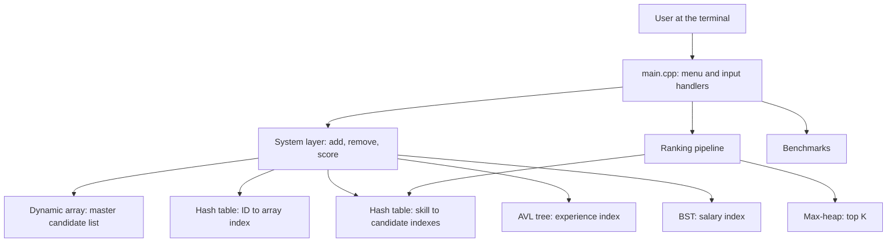
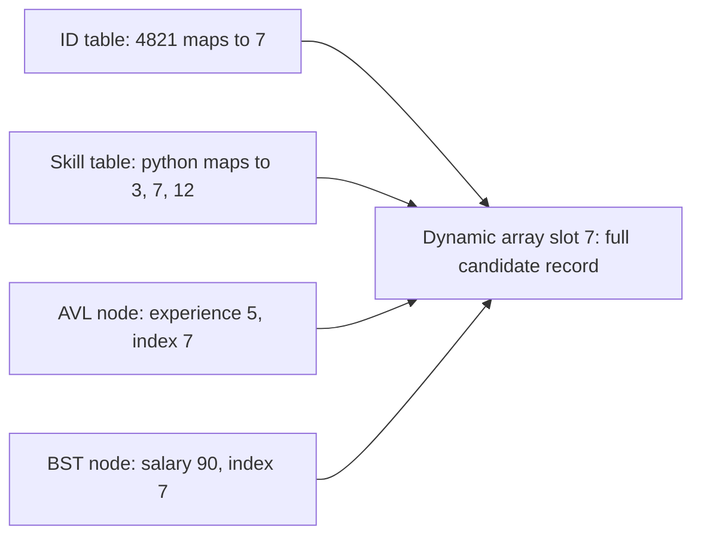
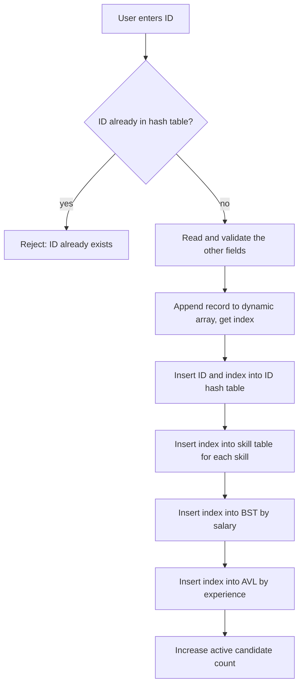
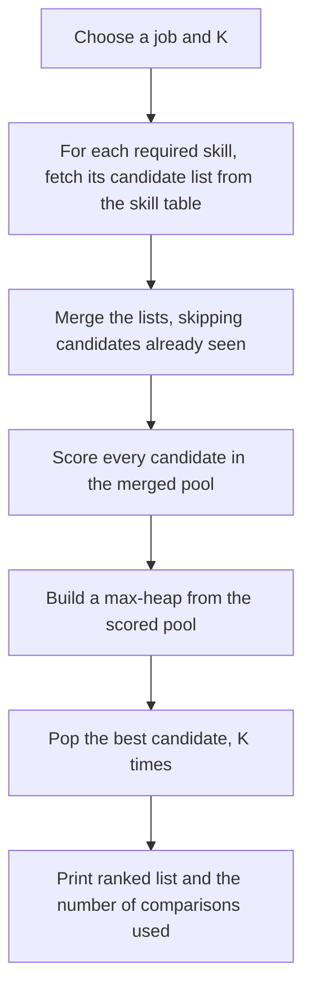

# SmartHire: AI-Powered Recruitment and Candidate Ranking System

A terminal application written in C++ that stores candidate profiles, matches them against job requirements, and ranks applicants with a weighted scoring mechanism. It is built entirely from hand-written data structures: **Dynamic Array, Hash Table, BST, AVL Tree and Heap**.

> **Course:** [DSA], Data Structures and Algorithms
> **Instructor:** [Mr. Sheroz Tariq]
> **Team:** Mohammed Ahmed Naeem and Muhammad Rayyan
> **Language:** C++ (only `<iostream>` is used; no STL containers, no `<string>`)

---

## Table of contents

1. [Project overview](#1-project-overview)
2. [Features](#2-features)
3. [Constraints and why they matter](#3-constraints-and-why-they-matter)
4. [System architecture](#4-system-architecture)
5. [Project structure](#5-project-structure)
6. [Data model](#6-data-model)
7. [Data structure design (what, why, how)](#7-data-structure-design-what-why-how)
8. [Key design decisions](#8-key-design-decisions)
9. [Workflows](#9-workflows)
10. [Scoring mechanism](#10-scoring-mechanism)
11. [Ranking pipeline](#11-ranking-pipeline)
12. [Input handling and validation](#12-input-handling-and-validation)
13. [Complexity summary](#13-complexity-summary)
14. [Benchmarks and results](#14-benchmarks-and-results)
15. [Testing plan](#15-testing-plan)
16. [Limitations and future work](#16-limitations-and-future-work)
17. [Build, run and menu reference](#17-build-run-and-menu-reference)
18. [Development process and team contributions](#18-development-process-and-team-contributions)

---

## 1. Project overview

### The problem

A recruiter receives hundreds or thousands of applications for a position. Reading them all is slow, and comparing candidates against a list of requirements by hand is inconsistent. The recruiter needs to:

- keep all candidate profiles in one place
- find a specific candidate immediately
- find everyone with a given skill
- filter by experience or expected salary
- get a ranked shortlist for a particular job

### The solution

SmartHire stores each candidate once and builds several **indexes** over that data. Each index is a different data structure, chosen because it is the best fit for one specific question:

| Question the recruiter asks | Structure that answers it |
|---|---|
| Where are all candidates kept? | Dynamic array |
| Show me candidate number 4821 | Hash table (by ID) |
| Who knows Python? | Hash table (by skill) |
| Who has between 3 and 6 years of experience? | AVL tree (by experience) |
| Who expects a salary between 60k and 90k? | BST (by salary) |
| Who are the best 10 candidates for this job? | Max-heap |

### What "AI-powered" means here

The ranking uses a **rule-based weighted scoring model**: it automatically turns a candidate profile and a job description into a single score out of 100. This is a form of automated decision support. It is **not machine learning**: nothing is trained, and the weights are chosen by hand and documented in [section 10](#10-scoring-mechanism). The model is isolated in one function so it can later be replaced by a learned model without touching the data structures.

---

## 2. Features

- Add, update and delete candidates
- Search by candidate ID
- Search by skill
- Range search by years of experience
- Range search by expected salary
- List all candidates
- Create and list job postings
- Rank candidates for a job and show the top K
- Generate up to 20,000 random sample candidates for testing
- Built-in benchmarks comparing the data structures
- Full input validation (the program does not crash on bad input)

---

## 3. Constraints and why they matter

| Constraint | Consequence for the design |
|---|---|
| Only `<iostream>` may be included | No `vector`, `string`, `queue`, `algorithm` or `<ctime>`. Every container, string function and sort is written by hand. |
| Required structures: Dynamic Array, BST, AVL, Heap, Hash Table | Each one must have a real job in the system, not just exist. Section 7 explains the job of each. |
| Terminal program | All interaction is through a numbered menu. A graphical front end is future work. |

Because `<ctime>` and `<chrono>` are not available, performance is measured by **counting comparisons** instead of measuring seconds. This is actually the better measurement for a data structures course: it does not depend on the computer, so the results are reproducible and match the theoretical analysis directly.

---

## 4. System architecture

### 4.1 Layers



The program has three layers:

1. **Interface layer** (`main.cpp`): reads input, validates it, prints results. It never touches the internals of a data structure.
2. **System layer** (in `implementation.cpp`): the functions that keep all the data structures consistent with each other (`addCand`, `removeCand`, `score`). This is the only place that knows all the structures exist.
3. **Data structure layer** (`implementation.cpp` and `header.h`): five independent structures. None of them knows about the others.

**Why layers:** a change in one layer should not force changes in another. The scoring formula can be changed without touching the heap. A data structure can be replaced without touching the menu.

### 4.2 One record, many indexes

There is exactly **one** copy of each candidate, stored in the dynamic array. Every other structure stores only the candidate's **array index** (a plain integer).



**Why:** see [section 8.1](#81-store-indexes-not-copies-or-pointers).

---

## 5. Project structure

```
smarthire/
  README.md
  header.h             shared declarations
  implementation.cpp   all definitions
  main.cpp             menu and input handling
  docs/                report, diagrams, benchmark output
```

| File | Responsibility | Why it is separate |
|---|---|---|
| `header.h` | Declares the data types, classes, function prototypes and global variables. It is the "table of contents" of the project. | Any file can include it to learn what exists without seeing how it works. |
| `implementation.cpp` | Defines everything declared in the header: helper functions, all five data structures, the system layer and the benchmarks. | Keeps the logic in one place; the header stays short and readable. |
| `main.cpp` | The menu, the input handlers and the program entry point. | The user interface changes most often. Isolating it means the engine stays untouched when the interface changes (for example, a future graphical front end). |

**Why a header and a separate implementation file:** the header contains declarations only, so it can safely be included in several files. Definitions in a header would be duplicated in every file that includes it and the linker would reject the program. Global variables are declared with `extern` in the header and defined once in `implementation.cpp`, so all files share a single copy.

---

## 6. Data model

### 6.1 Candidate

| Field | Meaning | Allowed values | Why this representation |
|---|---|---|---|
| ID | Unique identifier | 1 to 2,000,000,000 | An integer is fast to hash and compare. |
| Name | Candidate name | Up to 29 characters, no spaces | Fixed-size text avoids dynamic memory per candidate. No spaces because input is read word by word without `<string>`. |
| Experience | Years of experience | 0 to 60 | A small integer; also the key of the AVL tree. |
| Education | Level | 1 = Bachelors, 2 = Masters, 3 = PhD | Numeric levels make "meets or exceeds the requirement" a simple comparison. |
| Expected salary | In thousands | 1 to 10,000 | Integer keys are easy to order; thousands keep the numbers small. |
| Skills | Skill names | 1 to 8 skills, up to 19 characters each, lowercase | A fixed upper bound keeps each record the same size. Lowercase means "C++" and "c++" are the same skill. |
| Active flag | Whether the record is live | true / false | Allows deletion without moving data (see [8.2](#82-deletion-by-marking-not-shifting)). |

### 6.2 Job

| Field | Meaning | Allowed values |
|---|---|---|
| Title | Job title | Up to 29 characters, no spaces |
| Minimum experience | Years required | 0 to 60 |
| Minimum education | Level required | 1 to 3 |
| Required skills | Skills the job needs | 1 to 8 |

Up to 20 jobs can exist at a time.

**Why fixed limits:** every record has a known maximum size, so memory behaviour is predictable and there is no need for per-record dynamic allocation. The limits are comfortably larger than realistic profiles.

---

## 7. Data structure design (what, why, how)

For each structure: its **role** in the system, **why it was chosen** over alternatives, **how it works**, and its **trade-offs**.

### 7.1 Dynamic array: the master list

**Role:** the single place where candidate records live.

**Why a dynamic array:**
- Candidates are added over time and the final count is unknown, so a fixed-size array is either wasteful or too small.
- Appending is cheap and access by position is instant, which is exactly what every index needs (they all end up asking "give me the record at position i").
- Records sit next to each other in memory, which is efficient to scan when listing all candidates.

**Alternatives considered:**
- *Linked list:* cheap insertion but no instant access by position, which every other structure depends on.
- *Fixed array:* would force a hard limit on the number of candidates.

**How it works:**
1. It starts with a small capacity (4).
2. Adding a candidate places it in the next free slot and returns the slot number.
3. When full, it allocates a new array of **double** the capacity, copies all records, and frees the old one.

**Why doubling:** over many appends, the total copying work is at most about twice the number of records, so each append costs O(1) on average (amortized). Growing by a fixed amount instead would make appends cost O(n) on average.

**Trade-offs:** a resize momentarily costs O(n). Deleted records leave unused slots (see [8.2](#82-deletion-by-marking-not-shifting)).

### 7.2 Hash table (by ID): instant lookup

**Role:** given a candidate ID, find the array position in constant time.

**Why a hash table:** searching by ID is the most frequent operation (it happens on every add to check for duplicates, and on every update, delete and ID search). A linear scan would make each of these O(n). A hash table makes them O(1) on average.

**Alternatives considered:**
- *Scan the array:* simple but O(n); benchmarked in [section 14](#14-benchmarks-and-results) at roughly 840 times slower.
- *Use the ID as an array index:* IDs go up to two billion, so the array would be enormous and almost empty.
- *Search tree:* O(log n), slower than hashing for exact-match lookups.

**How it works:**
1. The hash function is `ID mod 1009`. This maps any ID to one of 1009 buckets.
2. Each bucket is a **linked list** (separate chaining). If two IDs land in the same bucket, both are stored in that bucket's list.
3. To search, compute the bucket and walk its (short) list.

**Why 1009 buckets:** it is a **prime number**. A prime table size spreads patterned IDs (for example IDs that are multiples of 10 or 100) more evenly than a round number, which would send them all to a few buckets.

**Why chaining and not open addressing:** deletion with chaining is trivial (remove one list node). Open addressing needs special "deleted" markers, and performance degrades sharply as the table fills. With chaining, performance degrades gradually.

**Trade-offs:** the table size is fixed. With very many candidates, chains get long (about n / 1009 entries each). A production version would resize and rehash when the load grows.

### 7.3 Hash table (by skill): fast matching

**Role:** given a skill name, return the list of all candidates who have it.

**Why:** ranking a job should not require looking at every candidate. By jumping straight to the candidates who have at least one required skill, the work depends on the number of **relevant** candidates, not on the size of the whole database.

**How it works:**
1. The hash function is **djb2**: start with 5381, then for each character compute `hash = hash x 33 + character`. The result is reduced to one of 53 buckets.
2. Each bucket holds a chain of **skill entries**. Each entry stores the skill name and a growing list of candidate array indexes.
3. Adding a candidate appends their index to the list of each of their skills. Removing a candidate deletes their index from those lists.

**Why djb2:** it is short, fast, and distributes text keys well in practice. Multiplying by 33 and starting from 5381 are well-known empirical choices. Unsigned arithmetic is used so overflow wraps predictably instead of causing undefined behaviour.

**Why only 53 buckets:** the number of **distinct skills** is small (tens, not millions). Each entry holds a whole list of candidates, so a collision only happens between different skill names, which is rare.

**Trade-offs:** removing a candidate needs to find their index inside each skill's list, which is a scan of that list. This makes removal cost proportional to the number of candidates sharing that skill. A possible improvement is storing each candidate's position inside the list.

### 7.4 AVL tree (by experience): guaranteed-fast ordered search

**Role:** keeps candidates ordered by years of experience so "between X and Y years" queries are fast and always efficient.

**Why a balanced tree:** a hash table cannot answer range questions because it does not keep keys in order. An ordered structure can find the start of a range in O(log n) and then walk through only the matching candidates.

**Why AVL specifically:** it **guarantees** logarithmic height regardless of the order in which candidates arrive. The system is read-heavy (many searches, fewer updates), and AVL trees are the most strictly balanced, which gives the fastest lookups.

**How it works:**
1. Each node stores a key, a candidate index, and its height.
2. On every insert or delete, heights are updated on the way back up.
3. The **balance factor** of a node is (height of left subtree) minus (height of right subtree). It must stay between -1 and 1.
4. If it leaves that range, the tree is fixed with rotations:

| Case | Meaning | Fix |
|---|---|---|
| Left-Left | left child's left side too tall | one right rotation |
| Right-Right | right child's right side too tall | one left rotation |
| Left-Right | left child's right side too tall | rotate the child left, then rotate right |
| Right-Left | right child's left side too tall | rotate the child right, then rotate left |

**Height guarantee:** at most about 1.44 x log2(n), so with 3000 candidates the height is about 12, no matter what.

**Deleting a node with two children:** the node takes the value of its **in-order successor** (the smallest node in its right subtree), the successor is deleted from the right subtree, and the tree is rebalanced upward.

### 7.5 BST (by salary): the simple ordered index

**Role:** keeps candidates ordered by expected salary for salary range queries.

**Why a BST is used alongside the AVL:** the project requires both. Using them side by side on two different keys also lets the system **demonstrate** the difference between an unbalanced and a balanced tree in the benchmarks. The BST is simpler (no rotations), and salaries in real data are not entered in sorted order, so the BST usually stays reasonably balanced.

**How it works:** for every node, smaller keys go in the left subtree and larger ones in the right. Insert and search follow a single path from the root downward. Deletion has three cases: no children (remove it), one child (replace the node with the child), two children (use the in-order successor).

**Trade-off, and the reason the AVL exists:** if keys arrive in sorted order, a plain BST degenerates into a linked list with height n and O(n) operations. The benchmark in section 14 measures this directly. In a production system the AVL tree would be used for both indexes.

### 7.6 How both trees handle duplicate keys

Many candidates share the same experience or salary. Each tree node is ordered by the **pair (key, array index)**, not by the key alone:

- The array index is unique, so the pair is unique. This gives a deterministic position for every node.
- It makes deletion exact: the system can remove precisely one candidate even if hundreds share the same key.
- Range queries stay correct. When searching for a range, the algorithm continues into a subtree whenever the node's key is **at least** the lower bound (or **at most** the upper bound), including equal keys, so no duplicates are missed.

### 7.7 Max-heap: top-K ranking

**Role:** returns the best K candidates for a job in order, without sorting all of them.

**Why a heap:** the recruiter wants the top 5 or top 10, not a fully sorted list of every applicant. A heap does less work than a full sort when K is small.

**How it works:**
1. The candidates are stored in an array shaped as a binary tree. The children of position i are at 2i+1 and 2i+2.
2. The **max-heap property**: every parent is better than or equal to its children, so the best candidate is always at the top.
3. **Building** the heap uses bottom-up heapify: starting from the last parent and moving to the root, each node is pushed down to its correct place. This costs O(n), cheaper than inserting one by one (O(n log n)), because most nodes are near the bottom and move very little.
4. **Extracting** the best: take the root, move the last element to the root, and push it down. Each extraction costs O(log n).

**Comparison rule (what "better" means):**
1. higher score wins
2. if scores are equal, more experience wins
3. if still equal, the lower ID wins

**Why the third rule:** it makes the ranking fully deterministic. The same input always produces the same output.

**Alternatives considered:**
- *Full sort of all candidates:* O(n log n) every time. Measured at 55,307 comparisons versus 9,641 for a top 10 on 5000 candidates.
- *Quickselect:* finds the top K in O(n) on average but returns them unordered, so they would still need sorting. The heap hands them over one by one, already in order.

**Trade-off:** as K approaches n, the heap loses its advantage (it becomes heap sort). It wins when K is much smaller than n.

### 7.8 Merge sort (benchmark baseline only)

Merge sort exists only so the benchmark has a fair "sort everything" opponent for the heap. It uses the same comparison rule as the heap. It is not used by any menu feature.

---

## 8. Key design decisions

### 8.1 Store indexes, not copies or pointers

Every structure other than the array stores the candidate's **array index**.

- **Why not copies:** a copy would have to be updated in every structure when the candidate changes. A single source of truth means one place to update.
- **Why not pointers:** when the dynamic array grows, it moves all records to a new block of memory. A pointer would then point to freed memory. An index stays valid, because position 7 is still position 7 after the move.

### 8.2 Deletion by marking, not shifting

Deleting a candidate sets their active flag to false instead of removing the slot and shifting everything after it.

- **Why:** shifting would cost O(n) and would change the position of every later candidate, which would invalidate the indexes stored in the hash tables and trees.
- **What it costs:** the slot is not reused, so memory used by deleted candidates is not reclaimed until the program ends.
- **Possible improvement:** periodic compaction that rebuilds all indexes.

When a candidate is deleted, they are removed from both hash tables and both trees, so they never appear in any search, range query or ranking. Only the array slot remains, marked inactive.

### 8.3 Update means delete and re-add

An update removes the old record from every structure and adds the new one. This is simpler and safer than updating each structure in place, because the experience and salary keys might have changed and the candidate would then belong in a different position in the trees. The cost is the same as one delete plus one add.

### 8.4 Count comparisons instead of timing

A global counter is increased at every key comparison in the hash table search, tree search and heap. See [section 3](#3-constraints-and-why-they-matter) for why.

### 8.5 Lowercase skills

Skills are converted to lowercase when read. Without this, "Python" and "python" would be different skills, would hash into different places, and would never match.

### 8.6 Skill table drives ranking

Ranking starts from the skill table, not from the whole array. See [section 11](#11-ranking-pipeline).

### 8.7 Own string and input functions

Since `<string>` and most of the standard library are not allowed, the project has its own functions for string length, copy, comparison and lowercase conversion. Input is read **one word at a time with a length limit**, so a very long entry cannot overflow a fixed-size field.

---

## 9. Workflows

### 9.1 Adding a candidate



The duplicate check happens **before** the remaining input is read, so the user does not type a full profile only to be told the ID is taken.

### 9.2 Deleting a candidate

1. Look up the ID in the hash table. If missing, report "not found".
2. Remove the ID from the ID hash table.
3. For each of the candidate's skills, remove their index from that skill's list.
4. Delete their node from the BST (by salary) and from the AVL (by experience).
5. Mark the array slot inactive and reduce the active count.

### 9.3 Updating a candidate

1. Confirm the ID exists.
2. Read the new details.
3. Delete the old record (9.2), then add the new one (9.1) under the same ID.

### 9.4 Searches

| Search | Method | Why it is fast |
|---|---|---|
| By ID | Hash the ID, walk one short chain | Constant time on average |
| By skill | Hash the skill, read its list | Constant time to find the list |
| By experience range | In-order walk of the AVL, skipping subtrees that cannot contain matches | Reaches the first match in O(log n), then only visits matches |
| By salary range | Same walk on the BST | Same idea, but no balance guarantee |
| List all | Scan the array, skipping inactive slots | Must show everything, so O(n) is unavoidable |

**How the range walk avoids unnecessary work:** at each node, go left only if the node's key is at least the lower bound (smaller keys on the left might still qualify), print the node if it is inside the range, and go right only if the node's key is at most the upper bound. Subtrees that are entirely outside the range are never visited.

---

## 10. Scoring mechanism

Each candidate receives a score from 0 to 100 for a given job.

| Component | Maximum points | Rule |
|---|---|---|
| Skills | 50 | 50 x (required skills the candidate has / total required skills) |
| Experience | 30 | Full 30 if the candidate meets the minimum. Otherwise 30 x (candidate years / required years). If the job has no minimum, full 30. |
| Education | 20 | Full 20 if the candidate meets or exceeds the required level. Otherwise 20 x (candidate level / required level). |

### Why these weights

- **Skills (50):** they decide whether a person can actually do the job, so they carry the most weight.
- **Experience (30):** important, but a strong candidate with slightly less experience can still be a good fit.
- **Education (20):** useful as a baseline, but the weakest predictor of fit for a specific job.

The weights live in one function. Changing them takes seconds and does not affect any data structure.

### Why partial credit instead of pass/fail

A candidate with 2 years of experience for a 3-year requirement is close, not hopeless. Proportional credit ranks near-misses above far-misses, which matches how a human recruiter thinks.

### Worked example

Job: required skills `cpp`, `python`, `sql`; minimum 3 years; minimum education Masters (level 2).

| Candidate | Skills | Experience | Education | Total |
|---|---|---|---|---|
| A: cpp, python, sql; 5 years; Masters | 50 x 3/3 = 50.00 | 30 (meets) | 20 (meets) | **100.00** |
| C: cpp, python; 3 years; Bachelors | 50 x 2/3 = 33.33 | 30 (meets) | 20 x 1/2 = 10.00 | **73.33** |
| B: cpp, java; 2 years; Bachelors | 50 x 1/3 = 16.67 | 30 x 2/3 = 20.00 | 20 x 1/2 = 10.00 | **46.67** |

Ranking: A, then C, then B.

### Tie-breaking

If two candidates have the same score, the one with **more experience** ranks higher. If that is also equal, the **lower ID** ranks higher.

### Known limitations of the model

- Skills must match exactly. "js" and "javascript" are different skills.
- Extra skills beyond the requirement earn no bonus.
- The weights are not learned from real hiring outcomes.

---

## 11. Ranking pipeline



### Step by step

1. **Gather:** for every required skill, read the list of candidates from the skill table.
2. **Remove duplicates:** a candidate who has two required skills appears in two lists. A visited-flag array makes sure each candidate is scored once.
3. **Score:** compute the 0-100 score for each candidate in the pool.
4. **Heapify:** build a max-heap from the scored pool in O(n).
5. **Extract:** pop the best candidate K times (or fewer, if the pool is smaller).

### Why this order

- Candidates who have **none** of the required skills are never scored. They would be poor matches anyway, and skipping them keeps the pool small.
- The heap is built **after** scoring, so it only contains relevant candidates.
- Printing the comparison count lets the user see the efficiency of the heap directly.

### Cost

Let p be the number of candidates in the pool, r the number of required skills (at most 8) and n the size of the array. The cost is about O(n) for the visited-flag array, plus the total length of the required skills' lists, plus O(p x r x s) for scoring (s is at most 8, so this is small), plus O(p) to build the heap, plus O(K log p) to extract the top K.

---

## 12. Input handling and validation

Every number is read through one function that:

- accepts only a whole number inside an allowed range
- on invalid input (letters, out-of-range values) clears the error, discards the bad line and asks again
- never crashes or loops forever on bad input

Every word is read through a function that:

- skips leading whitespace
- stops at the next whitespace
- **truncates** anything longer than the field, so memory is never overwritten

Other checks:

| Situation | Behaviour |
|---|---|
| Duplicate ID on add | Rejected before the rest of the profile is requested |
| Duplicate skill inside one profile or job | Rejected, the user is asked again |
| Update or delete of a missing ID | "Candidate not found" |
| Ranking with no jobs | "No jobs created" |
| Ranking when nobody has a required skill | "No candidate matches any required skill" |
| Range search with maximum below minimum | Prevented: the maximum is only accepted if it is at least the minimum |

---

## 13. Complexity summary

n = number of candidates, s = skills per candidate (at most 8), m = number of results returned, L = number of candidates sharing a skill.

| Operation | Structure used | Average | Worst case |
|---|---|---|---|
| Append a record | Dynamic array | O(1) amortized | O(n) on resize |
| Access by index | Dynamic array | O(1) | O(1) |
| Search by ID | Hash table | O(1) | O(n) |
| Find a skill's candidates | Skill hash table | O(1) | O(distinct skills) |
| Insert / search / delete by experience | AVL tree | O(log n) | O(log n) |
| Insert / search / delete by salary | BST | O(log n) | O(n) |
| Range query | AVL / BST | O(log n + m) | O(n) for the BST |
| Build heap | Heap | O(n) | O(n) |
| Extract the best | Heap | O(log n) | O(log n) |
| Top K | Heap | O(n + K log n) | O(n + K log n) |
| **Add a candidate (whole system)** | All | O(s + log n) | O(n) |
| **Delete a candidate (whole system)** | All | O(s x L + log n) | O(n) |

Deleting costs more than adding because removing an index from a skill's list means finding it first.

---

## 14. Benchmarks and results

### 14.1 Method

Menu option 13 runs three experiments. Each counts **comparisons** using a global counter, so results do not depend on the computer. The random numbers come from a fixed-seed generator, so the results are the same on every run.

### 14.2 Experiments

| Experiment | What is compared | Input |
|---|---|---|
| BST vs AVL | Height and average search steps | 3000 keys, inserted in sorted order and in random order |
| Heap vs full sort | Comparisons to get the top K | 5000 random candidates, K = 10, 100, 1000, against a full merge sort |
| Hash table vs linear scan | Average steps to find an ID | 5000 IDs, 1009 buckets |

### 14.3 Results

| Test | Result |
|---|---|
| BST, 3000 sorted keys | height **3000**, average **1500.5** steps |
| AVL, 3000 sorted keys | height **12**, average **10.64** steps |
| BST, 3000 random keys | height 26, average 13.54 steps |
| AVL, 3000 random keys | height 14, average 10.79 steps |
| Merge sort, 5000 candidates | 55,307 comparisons |
| Heap, top 10 | 9,641 comparisons |
| Heap, top 100 | 11,674 comparisons |
| Heap, top 1000 | 31,612 comparisons |
| Hash table, 5000 searches | average **2.98** steps |
| Linear scan, 5000 searches | average **2,500.5** steps |

### 14.4 What the results show

- **BST vs AVL:** on sorted input the plain BST collapses into a list (height 3000) and the AVL stays at height 12, about **140 times faster** per search. On random input the BST is only slightly worse, because random data keeps it roughly balanced. This is exactly why the AVL's guarantee matters: it does not depend on lucky input.
- **Heap vs sort:** a top 10 needs about **5.7 times fewer** comparisons than a full sort. The advantage shrinks as K grows (1.75 times at K = 1000), as predicted, because extracting everything is essentially heap sort.
- **Hash table vs linear scan:** about **840 times fewer** steps. With 5000 IDs in 1009 buckets, each chain holds about 5 entries, so a successful search takes about 3 steps.

All three results agree with the theory: O(log n) against O(n), O(n + K log n) against O(n log n), and O(1) against O(n).

---

## 15. Testing plan

Record the actual result of every test in a third column when you run it.

| # | Test | Steps | Expected result |
|---|---|---|---|
| 1 | Add a valid candidate | Option 1 with valid data | "Candidate added"; visible in option 6 |
| 2 | Duplicate ID | Add the same ID twice | Second attempt rejected immediately |
| 3 | Search by ID (exists) | Option 4 with an existing ID | Candidate printed |
| 4 | Search by ID (missing) | Option 4 with an unused ID | "Candidate not found" |
| 5 | Search by skill | Option 5 with a known skill | All candidates with that skill, and the count |
| 6 | Skill case | Add a candidate with `CPP`, search `cpp` | Candidate found |
| 7 | Update | Option 2 on an existing ID | Old values gone, new values shown, ID unchanged |
| 8 | Delete | Option 3, then options 4, 5, 7, 8, 11 | Candidate absent from every search and ranking |
| 9 | Experience range | Option 7 with 3 to 6 | Only candidates with experience between 3 and 6 inclusive |
| 10 | Salary range | Option 8 | Only candidates inside the range, inclusive |
| 11 | Duplicate keys in range | Add several candidates with identical experience, then range-search that value | All of them appear |
| 12 | Invalid number | Type letters where a number is expected | Error message and the question is asked again |
| 13 | Out-of-range number | Enter 99 for education | Range message and the question is asked again |
| 14 | Very long name | Enter a 100-character name | Truncated, program continues normally |
| 15 | Create a job | Option 9 | Appears in option 10 |
| 16 | Rank, normal | Option 11 on a job with matching candidates | Ranked list matches hand-calculated scores |
| 17 | Rank, tie | Two candidates with identical scores | Higher experience first, then lower ID |
| 18 | Rank, K above pool size | Ask for 1000 with 5 matches | Only 5 printed |
| 19 | Rank, no match | Job whose skills nobody has | "No candidate matches any required skill" |
| 20 | Rank after delete | Delete the top candidate, rank again | They no longer appear |
| 21 | Many records | Option 12 with 20000 | Generated successfully; searches and ranking still respond instantly |
| 22 | Benchmarks | Option 13 | Output matches the table in section 14 |

---

## 16. Limitations and future work

| Limitation | Why it exists | Possible improvement |
|---|---|---|
| Hash tables have fixed sizes (1009 and 53 buckets) | Simplicity | Resize and rehash when the load factor passes a threshold |
| Deleted candidates leave unused array slots | Keeps indexes stable | Periodic compaction that rebuilds all indexes |
| Deleting is slower than adding | Skill lists are scanned to find the index | Store each candidate's position inside every skill list |
| The salary BST can degrade on sorted input | Required by the project and kept to show the contrast | Use the AVL tree for both indexes |
| Names cannot contain spaces | No `<string>`, words are read one at a time | Read whole lines into a character buffer |
| Skills must match exactly | Simple comparison | Synonym table ("js" = "javascript") stored in a hash table |
| No bonus for extra skills | Keeps the formula easy to explain | Add a small capped bonus |
| Weights are hand-picked | No hiring data is available | Learn weights from past hiring decisions |
| Data is lost when the program ends | No file handling | Save and load from a file |
| Trees and skill tables are not freed on exit | The operating system reclaims memory at exit | Add destructors for long-running use |
| Terminal interface only | Scope of the project | A web or desktop front end that talks to the engine |

---

## 17. Build, run and menu reference

### Build

```
g++ main.cpp implementation.cpp -o smarthire
```

Both `.cpp` files must be compiled. Compiling only `main.cpp` fails at the linking step with "undefined reference" errors.

### Run

```
./smarthire
```

### Menu

| Option | Action | Structure involved |
|---|---|---|
| 1 | Add candidate | All structures |
| 2 | Update candidate | All structures (delete, then add) |
| 3 | Delete candidate | All structures |
| 4 | Search by ID | ID hash table |
| 5 | Search by skill | Skill hash table |
| 6 | List all candidates | Dynamic array |
| 7 | Search by experience range | AVL tree |
| 8 | Search by salary range | BST |
| 9 | Create job | Job storage |
| 10 | List jobs | Job storage |
| 11 | Rank candidates for a job | Skill hash table and heap |
| 12 | Generate sample candidates | All structures |
| 13 | Run benchmarks | Trees, heap, hash table |
| 0 | Exit | None |

### Suggested demo

1. Option 12, generate 300 candidates.
2. Option 4, search one ID.
3. Option 5, search the skill `cpp`.
4. Option 7, experience range 5 to 8.
5. Option 9, create a job with skills `cpp python sql`, minimum 3 years, Masters.
6. Option 11, rank the top 5.
7. Option 3, delete the top candidate, then option 11 again to show they are gone.
8. Option 13, show the benchmarks.

---

## 18. Development process and team contributions

### Plan

The project was built over seven days, with each day adding one layer on top of a program that always compiled.

| Day | Layer added |
|---|---|
| 1 | Repository, shared header, helper functions, data models, menu skeleton |
| 2 | Dynamic array, display and input helpers |
| 3 | Hash tables, add / update / delete, ID and skill search |
| 4 | BST and AVL tree, range search |
| 5 | Heap, job creation, scoring, ranking |
| 6 | Benchmarks and sample data generator, full testing |
| 7 | Documentation, test results, cleanup |

### Git workflow

- `main` always compiles.
- Each person works on a branch per day and merges through a pull request reviewed by the other.
- One logical change per commit, with a subject line and an explanatory body.

### Team contributions

| Member | Responsibility |
|---|---|
| Muhammed Ahmed Naeem | Helper functions, system layer (add, remove, scoring), menu and input handlers, documentation |
| [Muhammad Rayyan] | Data models, dynamic array, both hash tables, BST, AVL tree, heap, merge sort, benchmarks |

### Reading list

- Cormen, Leiserson, Rivest and Stein, *Introduction to Algorithms* (hash tables, binary search trees, heaps, amortized analysis)
- Adelson-Velsky and Landis, the original paper introducing AVL trees (1962)
